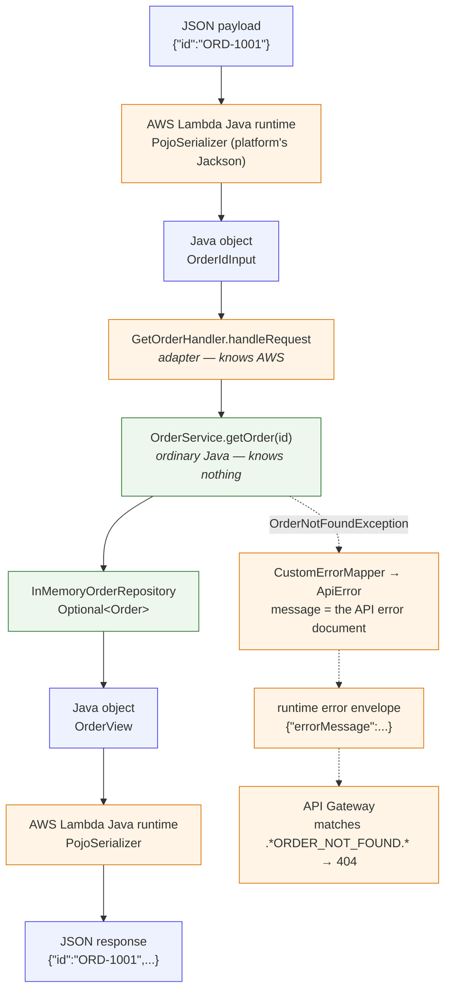
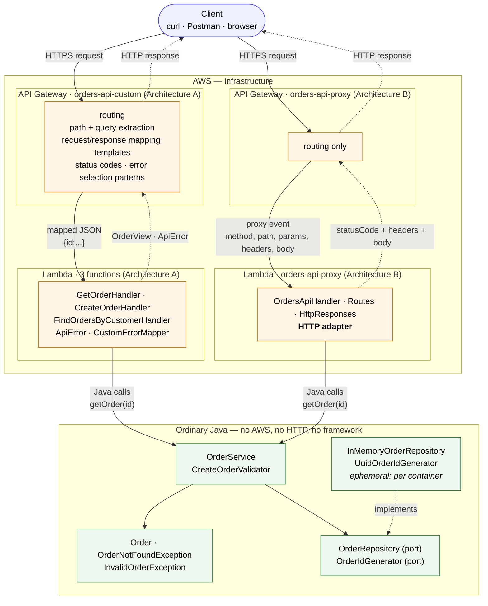

# Designing a Serverless REST API with AWS Lambda and API Gateway

Order Management API built twice on purpose: once with **API Gateway doing the HTTP work**
(custom/non-proxy integration) and once with **a thin HTTP adapter in Java** (Lambda proxy
integration), on top of one application that knows nothing about either.

Java 17 · Maven · AWS Lambda · Amazon API Gateway · JUnit 5 · 63 tests

```
POST    /orders                        201
GET     /orders/{id}                   200 / 404
GET     /orders?customerId={id}        200 / 400
```

The question this repository tries to answer is not "does it work" but **where should each
responsibility live** — and every non-obvious decision below is accompanied by the reason it was
made.

---

## Contents

| | |
| --- | --- |
| [Quick start](#quick-start) | build, test, deploy |
| [Repository layout](#repository-layout) | what is where |
| [Part 0 — Designing the API before writing code](#part-0--designing-the-api-before-writing-code) | contract + section 4 questions |
| [Part I — The application in plain Java](#part-i--the-application-in-plain-java) | + checkpoint 1 |
| [Part II — Running it on AWS Lambda](#part-ii--running-it-on-aws-lambda) | + how the runtime maps JSON, checkpoint 2 |
| [Parts III & IV — Architecture A](#parts-iii--iv--architecture-a-api-gateway-does-the-mapping) | mapping templates, HTTP semantics, checkpoint 3 |
| [Part V — Architecture B](#part-v--architecture-b-lambda-proxy-integration) | the HTTP adapter |
| [Comparing the two architectures](#comparing-the-two-architectures) | the eight questions |
| [AI-assisted development](#ai-assisted-development) | how the assistant was used and where it was wrong |
| [Final architecture diagram](#final-architecture-diagram) | required diagram |
| [Testing](#testing) | what is covered and how |
| [Deliverables](#deliverables) | where each required item lives |

---

## Quick start

```bash
# 1. Build and test — no AWS account needed
cd orders-api
mvn test
mvn package                       # -> target/orders-api.jar (shaded, 3.3 MB)

# 2. Deploy (from the repository root, Git Bash on Windows)
scripts/build.sh
scripts/deploy-lambdas.sh         # 4 functions from the same JAR
scripts/invoke-lambdas.sh         # Part II: Lambda alone, no HTTP
scripts/deploy-api.sh             # both APIs, from infra/openapi-*.yaml
scripts/smoke-test.sh proxy       # checks 200 / 201 / 400 / 404 over HTTP
scripts/smoke-test.sh custom
scripts/teardown.sh               # delete everything
```

Prerequisites: JDK 17+, Maven 3.8+, AWS CLI v2 with valid credentials.
In AWS Academy the scripts use the pre-existing `LabRole`, because the lab does not allow creating
IAM roles; see [`scripts/README.md`](scripts/README.md).

## Repository layout

```
.
├── orders-api/                           Maven project
│   ├── pom.xml
│   └── src/
│       ├── main/java/com/eci/orders/
│       │   ├── domain/                   Order, OrderNotFoundException, InvalidOrderException
│       │   ├── application/              OrderService, CreateOrderRequest, OrderRepository,
│       │   │                             CreateOrderValidator, OrderIdGenerator
│       │   ├── infrastructure/           InMemoryOrderRepository, UuidOrderIdGenerator,
│       │   │                             ApplicationFactory, DemoData
│       │   └── adapter/
│       │       ├── dto/                  OrderView, ErrorBody, ErrorCode   (the wire contract)
│       │       ├── json/                 Json, MalformedRequestException
│       │       └── lambda/
│       │           ├── custom/           Architecture A: one handler per operation
│       │           └── proxy/            Architecture B: OrdersApiHandler, Routes, HttpResponses
│       └── test/
│           ├── java/...                  63 tests, none of which need AWS
│           └── resources/events/          real API Gateway proxy events, replayed by a test
├── infra/
│   ├── openapi-proxy.yaml                Architecture B, importable into API Gateway
│   ├── openapi-custom.yaml               Architecture A, with mapping templates inline
│   ├── mapping-templates/*.vtl           the same templates, standalone and commented
│   └── API-GATEWAY-SETUP.md              console walkthrough + CLI equivalents
├── scripts/                              build, deploy, invoke, smoke-test, teardown
└── docs/
    ├── API-CONTRACT.md                   the contract, designed before any code
    ├── ARCHITECTURE.md                   diagrams, responsibility matrix, dependency rules
    ├── AI-REVIEW.md                      critique of the assistant's decisions
    ├── DEMO-SCRIPT.md                    what to record for the video
    ├── events/README.md                  where every HTTP element appears in the proxy event
    └── examples/                          real requests, responses and direct invocations
```

---

## Part 0 — Designing the API before writing code

The full contract is in [`docs/API-CONTRACT.md`](docs/API-CONTRACT.md) and, machine-readable, in
[`infra/openapi-proxy.yaml`](infra/openapi-proxy.yaml).

| Operation | Request | Success | Errors |
| --- | --- | --- | --- |
| Create an order | `POST /orders` + JSON body | `201` + order + `Location` | `400`, `500` |
| Retrieve an order | `GET /orders/{id}` | `200` + order | `400`, `404`, `500` |
| Find a customer's orders | `GET /orders?customerId=CUST-42` | `200` + array (may be `[]`) | `400`, `500` |

Every error, in either architecture, is the same document:

```json
{ "error": "ORDER_NOT_FOUND", "message": "Order ORD-999 does not exist" }
```

### What are the resources in your API?

Two: the collection `/orders` and the individual order `/orders/{id}`. `customer` and `product`
appear inside an order but are **not** resources here — nothing in this API creates, reads or
deletes a customer, so giving them URLs would promise something the API does not deliver.

### Why `/orders/{id}` to retrieve a particular order?

Because the identifier says *which order*, and identity belongs in the path. That gives every order
one stable, cacheable, bookmarkable URL that can be logged and returned in a `Location` header.
`GET /orders/get?id=ORD-1` would hide identity in a parameter and put a verb in a URL, leaving the
HTTP method with nothing to say.

### Why is `customerId` a query parameter in the search operation?

Because it does not identify a resource, it **filters** one. `GET /orders?customerId=CUST-42` is
"the orders collection, narrowed", which is why an unknown customer yields `200 []` and not `404`:
the collection exists, the filter simply matched nothing. Query parameters are also where future
modifiers (`?status=`, `?page=`) fit without inventing new URLs.

`/customers/{id}/orders` is also valid REST, and arguably reads better — but it implies that a
customer is a resource this API owns. It belongs to a Customers API, not this one.

### What should `POST /orders` return when an order is successfully created?

`201 Created`, with the created order as the body (so the client learns the server-assigned `id`
without a second call) and a `Location: /dev/orders/ORD-B2D04774` header pointing at the new
resource. `POST` on the collection — rather than `PUT /orders/{id}` — precisely because the client
does not know the id: the server mints it.

### What should the API return when an order does not exist?

`404 Not Found` with the standard error document naming the id that was not found. Not `200` with an
empty body (which would make the API lie to caches, retries and monitoring) and not `204` (which
would claim the order exists and is empty).

### What information should an error response contain?

A stable machine-readable `error` code that a client may branch on, a human-readable `message` for
whoever reads the log, and nothing else — no stack traces, no Java class names, no internal ids.
One shape for every error in the API, so a client needs one error-handling branch. The seven codes
are listed in [`docs/API-CONTRACT.md`](docs/API-CONTRACT.md) and declared once in code, in
[`ErrorCode`](orders-api/src/main/java/com/eci/orders/adapter/dto/ErrorCode.java).

---

## Part I — The application in plain Java

The application was written first, with no HTTP, no AWS and no framework:

```java
Order createOrder(CreateOrderRequest request);          // throws InvalidOrderException
Order getOrder(String id);                              // throws OrderNotFoundException
List<Order> findOrdersByCustomer(String customerId);
```

Three rules were applied, and they are what make the rest of the workshop cheap:

1. **The application reports outcomes, not status codes.** `OrderNotFoundException` carries the id
   that was missing, not the number 404. Each adapter decides the number — once.
2. **Storage is a port.** `OrderService` depends on the `OrderRepository` interface;
   `InMemoryOrderRepository` is one implementation and a DynamoDB one would need no change in the
   service, the handlers or the gateway.
3. **Validation is a business rule, so it lives in the business layer.**
   [`CreateOrderValidator`](orders-api/src/main/java/com/eci/orders/application/CreateOrderValidator.java)
   reports every violation at once, and `Order`'s constructor enforces the invariants again as a
   last line of defence.

About in-memory storage: a Lambda execution environment is ephemeral, so the `ConcurrentHashMap` in
`InMemoryOrderRepository` is **a cache, not persistence**. It lives as long as the container, is not
shared with other concurrent containers, and vanishes when AWS recycles the environment. Three demo
orders are therefore seeded at container start-up (`ORD-1001`, `ORD-1002` for `CUST-42` and
`ORD-1003` for `CUST-7`) so that read operations are demonstrable right after a cold start. This is
also why ids are random rather than sequential: see
[decision 6](docs/AI-REVIEW.md#decision-6--sequential-order-ids).

### Checkpoint 1

**Can the application functionality be tested without AWS?**
Yes, and that is the whole design. `OrderServiceTest`, `OrderTest` and
`InMemoryOrderRepositoryTest` import nothing from `com.amazonaws`; `mvn test` needs no credentials,
no network and no emulator. Even the two Lambda adapters are unit-tested locally, by constructing
their input objects directly.

**Does your application require a web server?**
No. Nothing listens on a port. The AWS runtime owns the process and calls `handleRequest`.

**Does it require Spring Boot?**
No. There is no framework at all, no dependency injection container and no component scanning —
wiring is three lines in
[`ApplicationFactory`](orders-api/src/main/java/com/eci/orders/infrastructure/ApplicationFactory.java).
A Spring Boot JAR would also add seconds of cold start for nothing.

**What does the generated JAR contain?**
A shaded ("fat") JAR: the 37 project classes plus `aws-lambda-java-core`,
`aws-lambda-java-events`, `jackson-databind`, `jackson-core` and `jackson-annotations`, 3.3 MB in
total. Lambda does not resolve Maven dependencies, so everything needed at runtime must be inside
the archive. There is no `Main-Class`: the entry point is the configured handler string.

**Which parts of your application currently know about HTTP?**
Only `adapter.lambda.custom` and `adapter.lambda.proxy`. `domain`, `application` and
`infrastructure` contain no mention of HTTP, status codes, headers or API Gateway — the
[dependency table in `docs/ARCHITECTURE.md`](docs/ARCHITECTURE.md#package-dependency-rule) lists this
package by package. Deleting both adapter packages leaves a project that still compiles and whose
application tests still pass.

---

## Part II — Running it on AWS Lambda

Four functions, **one artifact**: the configured handler string is what selects the entry point.

| Function | Handler | Architecture |
| --- | --- | --- |
| `orders-get-order` | `...custom.GetOrderHandler::handleRequest` | A |
| `orders-create-order` | `...custom.CreateOrderHandler::handleRequest` | A |
| `orders-find-orders-by-customer` | `...custom.FindOrdersByCustomerHandler::handleRequest` | A |
| `orders-api-proxy` | `...proxy.OrdersApiHandler::handleRequest` | B |

Runtime Java 17, 512 MB (more memory means more CPU, which shortens a Java cold start), 15 s
timeout. Reproduce with `scripts/deploy-lambdas.sh`, then `scripts/invoke-lambdas.sh`.

Real invocations, with two different inputs per operation, are recorded in
[`docs/examples/lambda-direct-invocations.md`](docs/examples/lambda-direct-invocations.md):

```bash
aws lambda invoke --function-name orders-get-order \
  --payload '{"id":"ORD-1001"}' --cli-binary-format raw-in-base64-out response.json

{"id":"ORD-1001","customerId":"CUST-42","product":"MacBook Air","quantity":1}
```

```bash
aws lambda invoke --function-name orders-get-order \
  --payload '{"id":"ORD-999"}' --cli-binary-format raw-in-base64-out response.json

{"errorMessage":"{\"error\":\"ORDER_NOT_FOUND\",\"message\":\"Order ORD-999 does not exist\"}",
 "errorType":"com.eci.orders.adapter.lambda.custom.ApiError"}
```

That second response is what a `404` looks like **before** API Gateway exists: Lambda has no concept
of a status code, so a mapped error is a *failed invocation* whose `errorMessage` happens to carry
the API's error document.

### Investigation: how does the runtime turn JSON into Java objects?

My code never parses JSON in Architecture A. `GetOrderHandler implements
RequestHandler<OrderIdInput, OrderView>`, and the managed runtime reads those two type parameters by
reflection to do the work around the handler method:

```
invocation payload (bytes)
   -> PojoSerializer (Jackson bundled in the runtime, not mine) -> OrderIdInput
   -> handleRequest(input, context)
   -> OrderView
   -> PojoSerializer -> response JSON
   -> (if it threw) {"errorMessage":..., "errorType":..., "stackTrace":[...]} + X-Amz-Function-Error
```

Verified against the deployed behaviour, with three consequences that are visible above and that
shaped the code:

* **The serializer is the platform's, not mine.** Its Jackson version is outside my control, so the
  types the runtime maps (`OrderIdInput`, `CreateOrderInput`, `OrderView`, `ErrorBody`) are mutable
  beans with a no-argument constructor rather than records. Inside the application, where this
  project owns Jackson 2.17, records are used freely. The line between the two is exactly where
  control over the serializer changes hands.
* **Absent fields arrive as `null`**, which is why `quantity` is an `Integer`. With `int`, a missing
  quantity would silently become `0` and the API would answer "must be greater than zero" instead of
  "quantity is required".
* **Unknown fields are ignored**, so a client sending an extra field does not break the function.

In Architecture B the same machinery runs, but the input type is `APIGatewayProxyRequestEvent` and
the HTTP body is a `String` inside it — so the adapter performs a second, explicit deserialization
that this project owns and tests. Full write-up:
[`docs/examples/lambda-direct-invocations.md`](docs/examples/lambda-direct-invocations.md#how-does-the-lambda-java-runtime-turn-json-into-java-objects).

### Checkpoint 2 — the actual solution



---

## Parts III & IV — Architecture A: API Gateway does the mapping

API Gateway extracts the parameters and builds the exact document each function expects, so the Java
code never sees a URL. The definition is
[`infra/openapi-custom.yaml`](infra/openapi-custom.yaml); the templates are also standalone and
commented in [`infra/mapping-templates/`](infra/mapping-templates/); the console walkthrough is
[`infra/API-GATEWAY-SETUP.md`](infra/API-GATEWAY-SETUP.md).

| Endpoint | Request mapping template | The Lambda receives |
| --- | --- | --- |
| `GET /orders/{id}` | [`get-order-request.vtl`](infra/mapping-templates/get-order-request.vtl) | `{"id":"ORD-1001"}` |
| `GET /orders?customerId=` | [`find-orders-request.vtl`](infra/mapping-templates/find-orders-request.vtl) | `{"customerId":"CUST-42"}` or `{"customerId":null}` |
| `POST /orders` | [`create-order-request.vtl`](infra/mapping-templates/create-order-request.vtl) | `{"customerId":...,"product":...,"quantity":...}` |

The `POST` template copies the three known fields explicitly instead of passing the body through
with `$input.json('$')`. That is deliberate: a client cannot smuggle extra fields into the function,
and a missing field arrives as an explicit `null` instead of being absent.

### HTTP semantics without a line of Java about HTTP

Success codes come from the integration response (`200` for the GETs, `201` for the `POST`). Failure
codes come from a regular expression matched against the failed invocation's `errorMessage`:

| Selection pattern | Status | Response template |
| --- | --- | --- |
| *(default)* | `200` / `201` | — |
| `.*ORDER_NOT_FOUND.*` | `404` | `$input.path('$.errorMessage')` |
| `.*(VALIDATION_ERROR\|MISSING_QUERY_PARAMETER\|MALFORMED_REQUEST).*` | `400` | `$input.path('$.errorMessage')` |
| `.*INTERNAL_ERROR.*` | `500` | a constant document |

The one-line template works because
[`ApiError`](orders-api/src/main/java/com/eci/orders/adapter/lambda/custom/ApiError.java) makes the
Lambda's error message *be* the JSON error body of the API, so the gateway only has to copy it out
unquoted.

Two limits of this architecture are worth stating plainly, because both were discovered while
building it:

* **No `Location` header on `201`.** An integration response parameter can copy a single field
  (`integration.response.body.id`) or a static string, but API Gateway mapping cannot concatenate
  `/orders/` with that id. The choices are to leak URL knowledge into the Lambda or to omit the
  header; this implementation omits it, and Architecture B sets it in one line of Java.
* **An unmapped failure returns `200`.** If a Lambda error matches no selection pattern, API Gateway
  falls back to the *default* integration response — which is the success one — so the client would
  receive `200 OK` with a stack trace in the body. `CustomErrorMapper` converts every unexpected
  exception into an `INTERNAL_ERROR` document precisely so there is always something to match.
  This trap does not exist in Architecture B.

### Checkpoint 3 — what API Gateway is responsible for here

| Responsibility | Where it lives in Architecture A |
| --- | --- |
| Routing (URL + method → function) | API Gateway |
| Extracting path parameters | API Gateway (`$input.params('id')`) |
| Extracting query parameters | API Gateway (`$input.params().querystring`) |
| Transforming the request | API Gateway (3 VTL templates) |
| Transforming the response | API Gateway (2 VTL templates) |
| Choosing the success status code | API Gateway (method/integration response) |
| Mapping errors to status codes | API Gateway (4 selection patterns per method) |
| Content negotiation / `415` | API Gateway (`passthroughBehavior: never`) |
| Deciding *that* something failed | Lambda (`ApiError`, `CustomErrorMapper`) |
| Business validation and rules | `OrderService` |

**Advantages of this distribution.** The Java code is remarkably clean — `GetOrderHandler` is eleven
lines and mentions no HTTP concept at all, and the functions are reusable from any caller, not just
from HTTP. The gateway rejects malformed content types before an invocation is paid for, each
operation scales and fails independently, and an operation's permissions can be scoped to exactly
what it needs. The HTTP contract is also declarative: `openapi-custom.yaml` is the whole truth about
status codes.

**Disadvantages.** The contract is split across two places that cannot be tested together: a Java
class decides the error *code*, a regular expression in the gateway decides the *status*, and
nothing in `mvn test` can tell you the regex is wrong — the only way to find out is to deploy and
call it. VTL is a second language with no type checking, no debugger and error messages like
"Invalid mapping expression". The 200-on-unmapped-error trap is invisible until it happens in
production. And the configuration grows per operation: three operations already need 3 request
templates, 12 method responses and 12 integration responses, which is why
`scripts/deploy-api.sh` exists — doing that by hand in a console is not repeatable.

---

## Part V — Architecture B: Lambda proxy integration

API Gateway stops transforming anything: it hands the whole HTTP request to one function as a JSON
event and returns whatever that function produced. Where every HTTP element appears in the event —
and the three fields that are easy to get wrong — is documented in
[`docs/events/README.md`](docs/events/README.md), with real events saved in
[`orders-api/src/test/resources/events/`](orders-api/src/test/resources/events/) and **replayed on
every `mvn test`** by `ProxyEventFixturesTest`, so the documented format cannot silently drift from
the code.

The adapter is three small classes, and nothing else in the project changed:

| Class | Responsibility |
| --- | --- |
| [`OrdersApiHandler`](orders-api/src/main/java/com/eci/orders/adapter/lambda/proxy/OrdersApiHandler.java) | route by resource + method, call the application, map outcomes to responses |
| [`Routes`](orders-api/src/main/java/com/eci/orders/adapter/lambda/proxy/Routes.java) | read the resource, the path parameter and the query parameters out of the event |
| [`HttpResponses`](orders-api/src/main/java/com/eci/orders/adapter/lambda/proxy/HttpResponses.java) | build every status code, header and error body of the API |

```java
} catch (OrderNotFoundException e) {
    return HttpResponses.error(404, ErrorCode.ORDER_NOT_FOUND, e.getMessage());
} catch (InvalidOrderException e) {
    return HttpResponses.error(400, ErrorCode.VALIDATION_ERROR, e.getMessage());
} catch (MalformedRequestException e) {
    return HttpResponses.error(400, ErrorCode.MALFORMED_REQUEST, e.getMessage());
} catch (RuntimeException e) {
    log(context, "Unhandled failure: " + e);               // CloudWatch gets the detail
    return HttpResponses.error(500, ErrorCode.INTERNAL_ERROR, "An unexpected error occurred");
}
```

The adapter knows about methods, paths, parameters, headers, status codes and JSON text. The
application below it still deals only in `Order`, `CreateOrderRequest`, customers, products and
quantities — the same `OrderService` instance type that Architecture A uses, unchanged.

`201` responses carry `Location: /dev/orders/{id}`, built from `requestContext.path` so that the URL
includes the stage and is actually reachable. `204` responses carry neither a body nor a
`Content-Type`.

### Who decides `405`?

The adapter implements `405 Method Not Allowed` with an `Allow` header, and tests prove it. But only
the methods declared in the gateway reach the Lambda: `PUT /orders` gets API Gateway's own
`403 Missing Authentication Token`. Declaring an `ANY` method instead would hand that decision to
Java. Both are defensible — explicit methods make the API self-documenting in the console and reject
nonsense without an invocation; `ANY` gives one consistent error vocabulary. This project keeps
explicit methods and documents the consequence rather than hiding it.

---

## Comparing the two architectures

Both are deployed, from the same JAR, serving the same contract.

| | A — gateway transformation | B — proxy integration |
| --- | --- | --- |
| Lambda functions | 3 | 1 |
| Mapping templates | 3 request + 2 response | 0 |
| Method + integration responses | 12 + 12 | 0 |
| Java classes that mention HTTP | 0 (but 4 that mention a gateway convention) | 3 |
| Status codes visible in `mvn test` | none | all |
| `Location` header | not expressible | one line |
| Lines of gateway config per new operation | ~30 | ~8 (one method) |
| Lines of Java per new operation | ~12 | ~6 (one `case`) |

**Which approach required more API Gateway configuration?**
A, by a wide margin: 3 request templates, 2 response templates, 12 method responses and 12
integration responses with 9 regular expressions, versus 3 methods pointing at one function.

**Which approach required more Java infrastructure code?**
B: `Routes`, `HttpResponses` and the routing/error-mapping inside `OrdersApiHandler`, about 200 lines
that in A are replaced by configuration. Note that A is not free of infrastructure code either —
`ApiError` and `CustomErrorMapper` exist only to satisfy an API Gateway convention.

**Which was easier to test locally?**
B, decisively. An `APIGatewayProxyRequestEvent` is a plain Java object, so the entire HTTP surface —
status codes, headers, `Location`, `Allow`, error bodies, malformed JSON, base64 bodies — is unit
tested with no gateway and no deployment. In A, local tests can only assert the document a handler
returns and the error code it throws; whether that code becomes a `404` is decided by a regex I
cannot execute from JUnit. The only way to test A's HTTP semantics is `scripts/smoke-test.sh`
against a deployed stage.

**Where are HTTP status codes defined in each approach?**
A: in the gateway — success codes in the integration response, failure codes in selection patterns
(`infra/openapi-custom.yaml`). B: in one Java file, `HttpResponses`, with the exception mapping in
`OrdersApiHandler`. In A the answer to "what status does this return?" is in the console; in B it is
in a file you can read, diff and review.

**What happens if the API grows from 3 operations to 30?**
A grows linearly in *configuration*: 30 functions, 30 templates, ~120 method/integration responses,
~270 regular expressions — and 30 deployment units to version together. That is where
infrastructure-as-code stops being optional and a console becomes untenable. B grows linearly in
*code*: 30 `case` branches in a router that is still one deployment unit, with one risk A does not
have — a single function whose cold start, memory and concurrency are shared by every operation, so
one slow endpoint can throttle the rest. At that scale I would split B per resource or per bounded
context rather than per operation.

**Which approach makes the Java business logic cleaner?**
Neither: `OrderService`, `Order` and the repository are byte-for-byte identical in both. That is the
most useful result of the whole exercise. What differs is the amount of HTTP-aware code *around* the
business logic, and A shrinks it only by moving it into VTL, where it is harder to test.

**Which approach would be easier for another developer to understand?**
B. The whole API can be understood by reading three Java files in an IDE, with `git log` explaining
every change. A requires reading a YAML document, understanding VTL, and knowing that a regular
expression on an error message is what produces a `404` — plus the two non-obvious traps above. A is
easier to *see* in the console, and harder to *reason about* anywhere else.

**Which approach would you choose for a larger system, and why?**
B — proxy integration with a thin Java adapter — for three reasons. First, testability: HTTP
behaviour becomes unit-testable, and on a 30-operation API that is the difference between a suite
that protects the contract and a suite that protects half of it. Second, reviewability: the contract
lives in code that fits in a pull request. Third, portability: the adapter is the only AWS-aware
part, so moving to ALB, to an HTTP API, or to a container behind a load balancer means writing one
new adapter, not redesigning the API.

I would keep A for narrow cases where its strengths are real: an endpoint that must reject bad
requests without paying for an invocation (gateway request validator), an integration that needs no
Java at all (API Gateway calling DynamoDB or SQS directly), or a function invoked from several
sources where an HTTP event shape would be noise.

---

## AI-assisted development

Claude (Claude Code) was used as a collaborator, not as a code generator. It was asked to propose
and justify an architecture before producing any file:

> I have a Java 17 AWS Lambda application implementing an Orders API with `POST /orders`,
> `GET /orders/{id}` and `GET /orders?customerId={customerId}`. I want to expose it through Amazon
> API Gateway twice: once with a custom (non-proxy) integration and once with proxy integration.
> Keep my application logic independent from AWS-specific classes. Before generating code:
> (1) propose the architecture; (2) identify which existing files should change; (3) identify any
> new classes required; (4) explain where HTTP responsibilities will reside. Do not implement
> anything until the architecture has been explained. Then tell me which of your decisions are
> trade-offs rather than facts, and what you would have chosen differently.

Six non-trivial decisions it made or proposed are reviewed in
[`docs/AI-REVIEW.md`](docs/AI-REVIEW.md) — one Lambda per operation, returning gateway types from
the service, records at the Lambda boundary, where validation lives, how Architecture A reports
errors, and sequential ids. Three were rejected outright, two were modified, one was kept.

The pattern in its mistakes is worth more than the list: it was reliable about **mechanics** (the
shape of a mapping template, which Maven plugin builds a fat JAR) and unreliable about
**boundaries** — every proposal I rejected moved a decision to wherever the code was shortest rather
than to where the decision belongs. Returning `200 OK` for a missing order was the clearest example:
it works, it is simple, and it is wrong.

---

## Final architecture diagram



Solid arrows are requests, dashed arrows are responses. Everything inside **AWS** (orange) depends
on `com.amazonaws` classes or on API Gateway configuration; everything in **Ordinary Java** (green)
is plain Java that compiles and is tested without an AWS account. Dependencies only ever point
inwards: the adapters know about the application, the application knows nothing about the adapters.

More diagrams — including the per-architecture sequence diagrams and the package dependency
graph — are in [`docs/ARCHITECTURE.md`](docs/ARCHITECTURE.md).

---

## Testing

```bash
cd orders-api && mvn test
```

```
Tests run: 63, Failures: 0, Errors: 0, Skipped: 0
BUILD SUCCESS
```

| Test class | What it protects |
| --- | --- |
| `OrderTest` | domain invariants: blank id/customer/product, non-positive quantity, value semantics |
| `OrderServiceTest` | the use cases: creation, retrieval, missing order, search, empty result, every invalid input, all-violations-at-once |
| `InMemoryOrderRepositoryTest` | storage behaviour: replace on same id, filter by customer, ordering, seeding |
| `CustomIntegrationHandlersTest` | Architecture A: returned documents, the error code inside every `ApiError`, `INTERNAL_ERROR` leaking nothing |
| `OrdersApiHandlerTest` | Architecture B: every status code, `Location`, `Allow`, malformed JSON, base64 body, missing parameter, unknown route, null event, 500 |
| `ProxyEventFixturesTest` | the saved API Gateway events still work against the real handler |

What tests cannot cover, and is therefore verified against a deployed stage by
`scripts/smoke-test.sh`: Architecture A's selection patterns (whether `ORDER_NOT_FOUND` really
becomes a `404`), the VTL templates themselves, and the gateway's own `403` for undeclared methods.
Knowing exactly where the untested boundary is, is part of the answer to "where should each
responsibility live".

---

## Deliverables

| Required item | Where |
| --- | --- |
| Complete Java source code | [`orders-api/src/main/java`](orders-api/src/main/java) |
| Maven configuration | [`orders-api/pom.xml`](orders-api/pom.xml) |
| Unit tests | [`orders-api/src/test/java`](orders-api/src/test/java) — 63 tests |
| Lambda handlers | [`adapter/lambda/custom`](orders-api/src/main/java/com/eci/orders/adapter/lambda/custom) (A), [`adapter/lambda/proxy`](orders-api/src/main/java/com/eci/orders/adapter/lambda/proxy) (B) |
| API Gateway configuration | [`infra/openapi-proxy.yaml`](infra/openapi-proxy.yaml), [`infra/openapi-custom.yaml`](infra/openapi-custom.yaml), [`infra/mapping-templates/`](infra/mapping-templates), [`infra/API-GATEWAY-SETUP.md`](infra/API-GATEWAY-SETUP.md) |
| Example requests and responses | [`docs/examples/requests-responses.md`](docs/examples/requests-responses.md), [`docs/examples/lambda-direct-invocations.md`](docs/examples/lambda-direct-invocations.md) |
| Example API Gateway event | [`orders-api/src/test/resources/events/`](orders-api/src/test/resources/events) + [`docs/events/README.md`](docs/events/README.md) |
| Architecture diagram | [above](#final-architecture-diagram) and [`docs/ARCHITECTURE.md`](docs/ARCHITECTURE.md) |
| Answers to the architectural questions | this README (Part 0, checkpoints 1–3, the comparison) |
| Analysis of the AI assistant's decisions | [`docs/AI-REVIEW.md`](docs/AI-REVIEW.md) |
| Build and test instructions | [Quick start](#quick-start), [`scripts/README.md`](scripts/README.md) |
| Demonstration video | script in [`docs/DEMO-SCRIPT.md`](docs/DEMO-SCRIPT.md) |

---

## The main question

> Where should each responsibility live?

The rule this project ended up following:

* **API Gateway** owns what is about *addressing and transport*: which URL maps to which code, TLS,
  content types, throttling, and — only in Architecture A — turning a request into a document.
* **The HTTP adapter** owns what is about *HTTP semantics*: reading parameters out of a request,
  choosing status codes, setting headers, serializing JSON, and turning a domain outcome into a
  response. It is the only part allowed to know both worlds, and it is deliberately thin.
* **The application** owns what would still be true if HTTP disappeared tomorrow: what an order is,
  that a quantity must be positive, that a missing order is an error, and what it means to create
  one.

The test for whether a responsibility is in the right place turned out to be a simple question: *if
this API were invoked from a CLI, an SQS consumer or another service, would this code still be
needed?* If yes, it belongs in the application. If it only makes sense because a human typed a URL,
it belongs in the adapter — or in the gateway.
