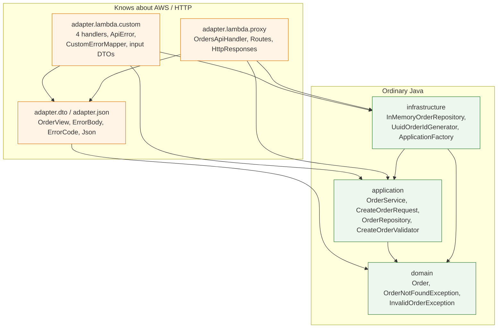
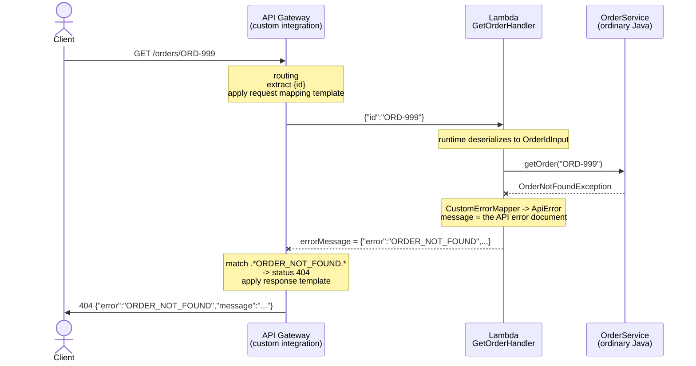
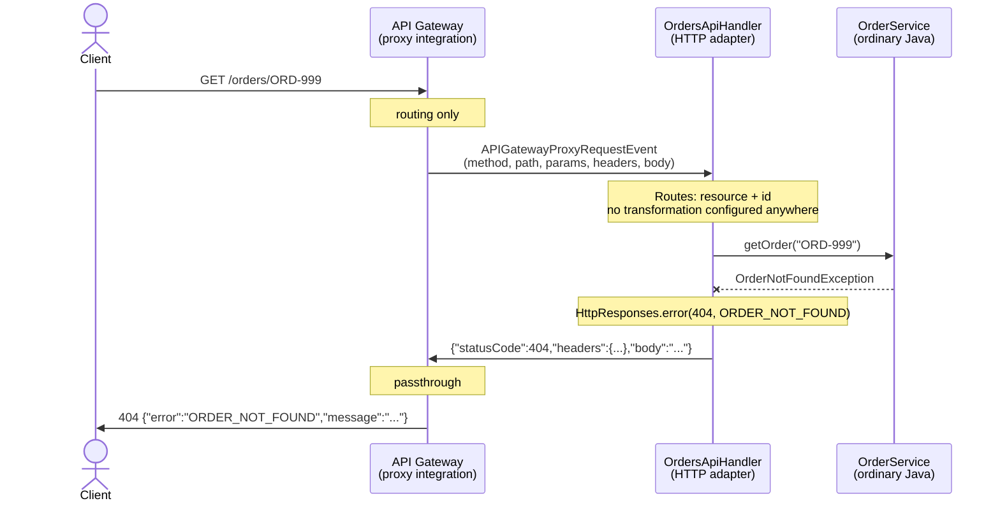

# Architecture in detail

The final diagram is in [`../README.md`](../README.md). This document holds the per-architecture
detail, the responsibility matrix and the dependency rules that keep the application independent
from AWS.

## Package dependency rule



Every arrow points inwards. `application` and `domain` import nothing from `com.amazonaws`,
`com.fasterxml` or `adapter`, which is checked the hard way: removing both adapter packages leaves a
project that still compiles and whose tests still pass.

| Package | Imports AWS types? | Imports Jackson? | Tested without AWS? |
| --- | --- | --- | --- |
| `domain` | no | no | yes |
| `application` | no | no | yes |
| `infrastructure` | no | no | yes |
| `adapter.dto` | no | no | yes |
| `adapter.json` | no | yes | yes |
| `adapter.lambda.custom` | yes (`RequestHandler`, `Context`) | indirectly | yes |
| `adapter.lambda.proxy` | yes (+ proxy event types) | yes | yes |

## Architecture A — API Gateway transformation



Four Lambda functions for four operations, three request mapping templates (the `GET` one is reused
by the `DELETE`), two response templates, and four method responses plus four integration responses
*per method* — 35 pieces of gateway configuration in total.

## Architecture B — proxy integration



One Lambda function, four methods declared in the gateway, and every HTTP decision in two small
Java files (`Routes`, `HttpResponses`) plus the router inside `OrdersApiHandler`.

## Responsibility matrix

| Responsibility | Architecture A | Architecture B |
| --- | --- | --- |
| Routing (URL + method → code) | API Gateway | API Gateway (resource) + `OrdersApiHandler.route()` (method) |
| Extract path parameter | API Gateway mapping template | `Routes.orderIdOf()` |
| Extract query parameter | API Gateway mapping template | `Routes.queryParameter()` |
| Read the request body | API Gateway mapping template | `Json.read()` in the adapter |
| JSON → Java | AWS runtime (into a DTO) | AWS runtime (into the event) + adapter (the body) |
| Java → JSON | AWS runtime | adapter (`Json.write`) |
| Status code on success | API Gateway method/integration response | `HttpResponses` |
| Status code on error | API Gateway selection patterns | `OrdersApiHandler` catch clauses |
| Error body | Lambda (`ApiError`) + response template | `HttpResponses.error()` |
| `Location` header | not possible without leaking URLs into the Lambda | `HttpResponses.created()` |
| `Allow` header on 405 | not implemented (gateway answers 403) | `HttpResponses.methodNotAllowed()` |
| Dropping the body of a 204 | API Gateway (empty response template) | `HttpResponses.noContent()` |
| Business validation | `OrderService` / `CreateOrderValidator` | same |
| Business rules and data | `OrderService`, `Order`, repository | same |

The last two rows are the point of the whole exercise: they are identical. Changing the integration
style changed the adapter and the gateway configuration, and nothing else.

## What the JAR contains

```
orders-api.jar (3.3 MB, shaded)
├── com/eci/orders/...                 29 application + adapter classes
├── com/amazonaws/services/lambda/...  aws-lambda-java-core, aws-lambda-java-events
├── com/fasterxml/jackson/...          jackson-core, jackson-databind, jackson-annotations
└── org/joda/time/...                  joda-time, pulled in transitively by the events library
```

Lambda does not resolve Maven dependencies, so everything the function needs at runtime has to be
inside the archive. That is the whole reason `maven-shade-plugin` is in the build. No web server, no
servlet container, no framework: the `main` entry point is provided by the AWS runtime, which calls
`handleRequest`.
